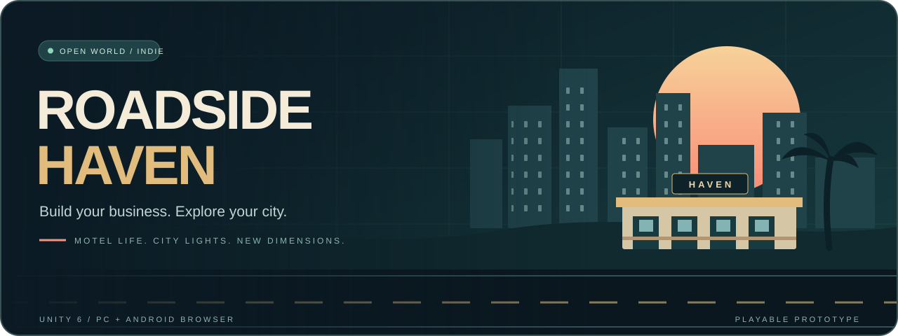
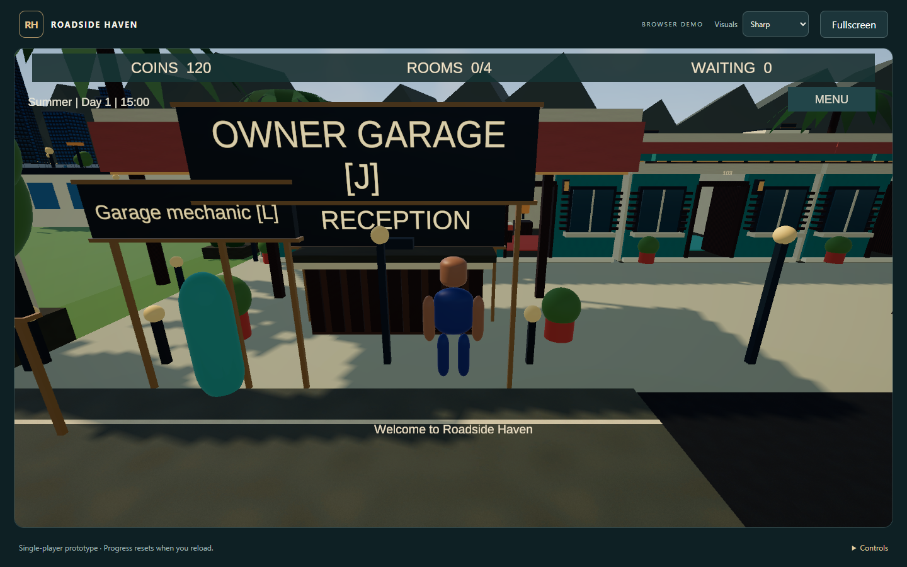
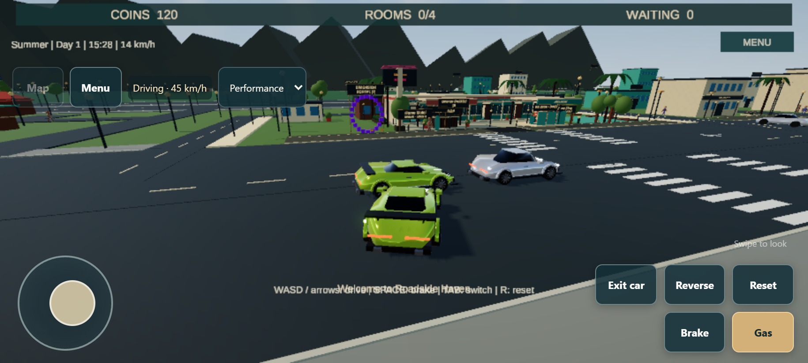

<div align="center">



### One motel. A whole city of possibilities.

Run the reception. Hit the road. Build a business empire across dimensions.

**[▶ PLAY THE LIVE DEMO](https://farhan2580.github.io/Road_side_Haven/)** &nbsp; · &nbsp; **[Latest releases](https://github.com/Farhan2580/Road_side_Haven/releases)** &nbsp; · &nbsp; **[Report an issue](https://github.com/Farhan2580/Road_side_Haven/issues)**


[Explore](#the-world-of-roadside-haven) · [How to play](#jump-in) · [Controls](#take-control) · [Development](#build-it-yourself)

</div>

---

**Roadside Haven** is a single-player Unity game prototype that brings motel management, third-person exploration and an open driving world together. You are the owner: welcome guests, clean rooms, stock your shop and leave the front desk to explore the town yourself.

The visual direction is **semi-realistic stylized**: vivid environments, modern districts, roadside businesses and a world that changes from day to night. The current demo uses procedural and primitive-based 3D art while the world is built out area by area.

## Jump in

**[Open the game in your browser →](https://farhan2580.github.io/Road_side_Haven/)**

| On your computer | On your Android phone |
| :--- | :--- |
| Open the demo, press **Play**, then click the game to focus it. | Open the demo in **Chrome**, turn your phone sideways and press **Play**. |
| Use the keyboard to move and the mouse to look around. | Move with the left joystick and swipe the right side to look around. |
| Start with **Sharp** visuals; choose Balanced or Performance if needed. | **Performance** is selected automatically. Change Visuals whenever you like. |

No Unity installation is needed to play. The first launch downloads the game, so allow time for the loading bar to finish. This is a browser demo; an Android APK is not included.

> **Prototype note:** progress resets when the game reloads. Phone controls have been checked in Android browser emulation; performance on a physical phone depends on the device.

## Inside the demo

<table>
  <tr>
    <td width="50%"></td>
    <td width="50%"></td>
  </tr>
  <tr>
    <td align="center"><strong>Your motel. Your starting point.</strong><br />Third-person exploration on desktop.</td>
    <td align="center"><strong>Take the city for a drive.</strong><br />Touch controls in Android browser emulation.</td>
  </tr>
</table>

<sub>Actual captures from the published demo. The cover artwork is a graphic illustration.</sub>

## The world of Roadside Haven

| Experience | What you can do |
| :--- | :--- |
| 🏨 **Life behind the front desk** | Check in guests, assign rooms, clean up after checkout and keep the motel running. |
| 🛒 **Your own roadside shop** | Manage stock, scan products and handle customers alongside the motel business. |
| 🚗 **Leave the desk behind** | Walk in third person, enter nearby cars, CNGs, trucks or buses, and explore with a chase camera. |
| 📦 **Work around town** | Bring in supplies, take NPC quests and build relationships and reputation. |
| 🏙️ **A growing open world** | Explore a 2 km × 2 km regional base with modern downtown blocks, restaurant plazas, village areas and roadside districts. |
| 👥 **People with individuality** | Meet young, adult and senior characters with varied faces, hair, outfits and articulated walking. Town population targets are 192 on PC and 128 on phones, with local pedestrian avoidance. |
| 🚦 **Streets with a routine** | Encounter traffic signals, pedestrian crossings, sidewalks, commuters, school transport and police patrols. Drivers anticipate queues and brake according to the gap ahead. |
| 🌅 **A changing atmosphere** | See seasonal visuals and street, building and garden lighting, with an 80% day / 20% night cycle. |
| 🏦 **Beyond one business** | Purchase and upgrade businesses, collect income and unlock more of the business portfolio. |
| 🔮 **Four dimensions** | Visit Normal, Neon, Apocalypse and Fantasy overlays with separate wallets and cross-universe item trading. |

The dimensions currently share the same physical map. Town activity is a finite simulation; this demo does not include complete building interiors, medical treatment, arrests or full combat. Save/load and player-controlled helicopter flight are not implemented.

## Take control

### PC / laptop

| Input | Action |
| :--- | :--- |
| **W A S D** / arrow keys | Walk or drive |
| **Mouse** / scroll wheel | Look around / adjust camera distance |
| **Shift** | Sprint |
| **Space** | Jump on foot / brake while driving |
| **E** or **F** | Enter or exit a nearby vehicle |
| **G** | Interact with nearby work or services |
| **M** or **P** | Switch between the management map and walking |
| **J** / **L** | Garage and quests / NPC dialogue |
| **T** / **B** | Dimensional portal / business portfolio |
| **R** | Reset the active vehicle |
| **Escape** | Release the cursor and close menus |

**MENU** contains actions and controls help. Stop the vehicle before getting out. Developer preview keys: **F6** sunset, **F7** night, **F8** season and **F9** management camera view.

### Android / touch

| Control | Action |
| :--- | :--- |
| **Left joystick** | Walk on foot / steer while driving |
| **Swipe on the right** | Turn the camera |
| **Run** + joystick / **Jump** | Sprint / jump |
| **Enter car** / **Exit car** | Use a nearby vehicle / leave it once stopped |
| **Gas** / **Reverse** / **Brake** | Accelerate, reverse and stop |
| **Use** / **Talk** | Nearby interaction / NPC dialogue |
| **Map** / **Menu** / **Back** | Change view, open actions or close a panel |
| **Reset** | Reset the active vehicle |

Touch steering, gas and camera movement support separate fingers at the same time. Use **Fullscreen** for more screen space; the controls stay visible.

## Build it yourself

**Editor:** Unity **6000.3.28f1** · **Renderer:** Universal Render Pipeline · **Language:** C#

1. Clone this repository and open the project through Unity Hub.
2. Wait for package import and script compilation to finish.
3. Open [`RoadsideHavenPrototype.unity`](Assets/_Game/Generated/RoadsideHavenPrototype.unity).
4. Choose **Roadside Haven → Apply Visual Upgrade**, then save the scene to include generated additions in builds.
5. Press **Play**.

If the scene is missing, choose **Roadside Haven → Create or Update Prototype**. Keep custom work outside the generated layers. Editor previews can create additions during Play Mode; save their Edit Mode versions before building.

<details>
<summary><strong>Project layout & tuning</strong></summary>

| Location | Purpose |
| :--- | :--- |
| [`Assets/_Game/Core`](Assets/_Game/Core) | Player movement, driving, cameras and world systems |
| [`Assets/_Game/Hotel`](Assets/_Game/Hotel) · [`Shop`](Assets/_Game/Shop) | Motel operations and shop gameplay |
| [`Assets/_Game/Business`](Assets/_Game/Business) · [`Multiverse`](Assets/_Game/Multiverse) | Business progression and dimensional systems |
| [`Assets/_Game/AI`](Assets/_Game/AI) · [`Town`](Assets/_Game/Town) | Vehicles, citizens and town activity |
| [`Assets/_Game/Editor`](Assets/_Game/Editor) | World builders, installers and browser export tools |
| [`Assets/_Game/Tests/Editor`](Assets/_Game/Tests/Editor) | Unity regression and physics tests |
| [`Assets/WebGLTemplates/RoadsideHaven`](Assets/WebGLTemplates/RoadsideHaven) | Browser loading screen, visuals settings and touch controls |
| [`scripts`](scripts) · [`.github/workflows`](.github/workflows) | Local preview, deployment checks and GitHub Pages workflows |

Tune motel gameplay in [`HotelSettings.asset`](Assets/_Game/Generated/HotelSettings.asset) and business progression in [`BusinessCatalog.asset`](Assets/_Game/Business/Configuration/BusinessCatalog.asset) after installation.

Assets and their `.meta` files, Packages and ProjectSettings are versioned. Unity caches, exported builds, local backups and IDE-generated project files are ignored.

</details>

<details>
<summary><strong>Export & preview the browser game</strong></summary>

1. In Unity Hub, add **Web Build Support** to Unity **6000.3.28f1**.
2. In the Editor, choose **Roadside Haven → Web Demo → Build Browser Demo**.
3. With Node.js installed, run:

```sh
node scripts/serve-web-demo.mjs
```

4. Open **http://127.0.0.1:8080/**.

Serve the export over HTTP or HTTPS; opening `index.html` directly from disk will not run it.

The export includes **DXT** texture data for desktop and **ETC2** for Android. The browser selects the appropriate data and shares the engine download when compatible. Static hosting uses gzip decompression fallback, hashed game assets and single-threaded WebGL.

Desktop **Sharp** uses full render scale, up to 2× display pixel density and 2× MSAA. Phones default to **Performance**, a **30 FPS target** and a shorter view distance. Balanced and Performance reduce canvas resolution without restarting the game; the FPS target is not a guarantee on every device.

</details>

<details>
<summary><strong>Publish updates to the live demo</strong></summary>

**Tested local build → GitHub Release → GitHub Pages**

1. Build and test the browser export.
2. Zip the **contents** of `Builds/WebGL`, with `index.html` at the archive root, using forward-slash archive paths.
3. Name the archive **`RoadsideHaven-WebGL.zip`** and attach it to a GitHub Release whose tag begins with **`web-demo-`**.
4. Publish the release. The **Publish browser demo** workflow validates the archive and deploys it to the same live URL.

Existing release builds can also be deployed from **Actions → Publish browser demo → Run workflow**, using the release tag. Pages must use **GitHub Actions** as its build source.

**Automatic builds from source pushes**

The **Web demo** workflow supports building saved game changes pushed to `main` after Unity cloud activation is configured. Follow [GameCI's Personal license activation guide](https://game.ci/docs/github/activation/), then add repository Actions secrets named `UNITY_LICENSE`, `UNITY_EMAIL` and `UNITY_PASSWORD` directly in GitHub. Paid or floating licenses need the corresponding GameCI setup.

Without those activation secrets, the source-build workflow skips building and keeps the existing demo available. Release-based publishing does not require them. A failed build does not replace the current live game.

</details>

<details>
<summary><strong>Validation & troubleshooting</strong></summary>

The character and town update was checked with **92 passing Unity tests**, **22 passing browser/deployment tests** and **one Windows-only symlink test skip**. Desktop Chrome and Android Chrome emulation both loaded the public demo successfully. Touch checks covered walking, vehicle entry, simultaneous steering/gas, braking, exiting, camera swipes and menu/back actions.

Run Unity tests through **Window → General → Test Runner**, using the tests in `Assets/_Game/Tests/Editor`. Run browser tooling checks with:

```sh
node --test scripts/*.test.mjs
node scripts/validate-web-build.mjs Builds/WebGL
```

| If you see… | Try this |
| :--- | :--- |
| Low frame rate | Select **Performance**, close background tabs and reduce other running apps. |
| Soft or blurry graphics | Choose **Balanced** or **Sharp** if your device can handle it. |
| No keyboard response | Click inside the game; press Escape to release the cursor. |
| No touch controls after an update | Reload the page in Android Chrome and check that the latest demo has loaded. |
| Vehicle will not exit | Brake to a stop and leave room beside the vehicle. |
| Game fails to load | Reload, use a current browser with WebGL 2 support and check the connection. |

Physical Android hardware testing, wider browser coverage and device-specific performance tuning remain ongoing work.

</details>

---

<div align="center">

**Built by [Farhan2580](https://github.com/Farhan2580) with Unity. Growing one district at a time.**

Found something broken? [Open an issue](https://github.com/Farhan2580/Road_side_Haven/issues) with your device, browser, steps and a screenshot.

<sub>Third-party resources retain their respective notices. See the repository files for applicable terms.</sub>

</div>
